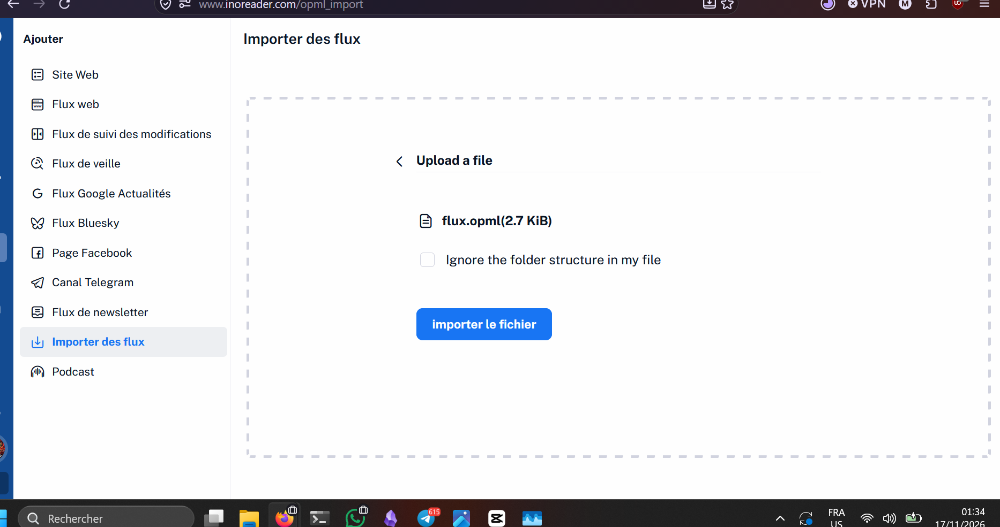
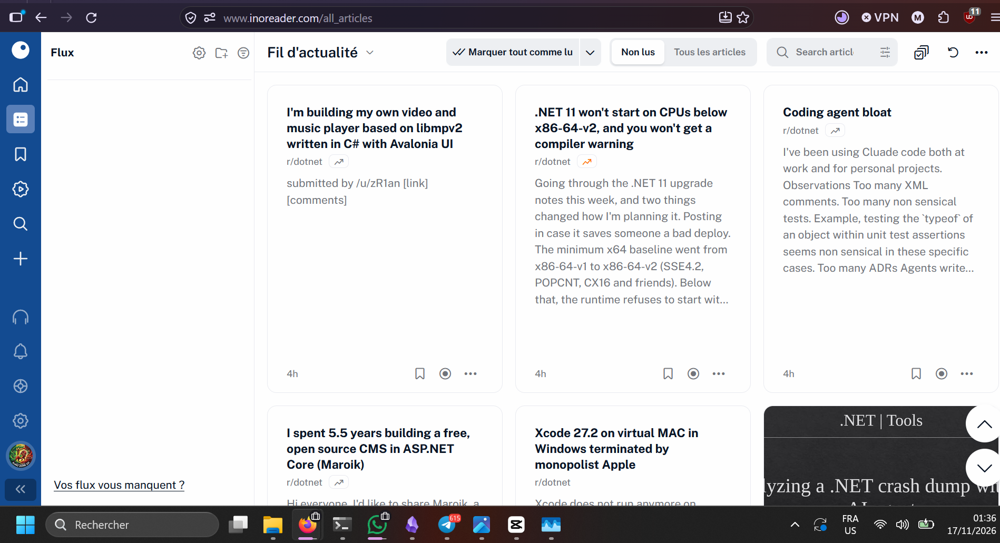
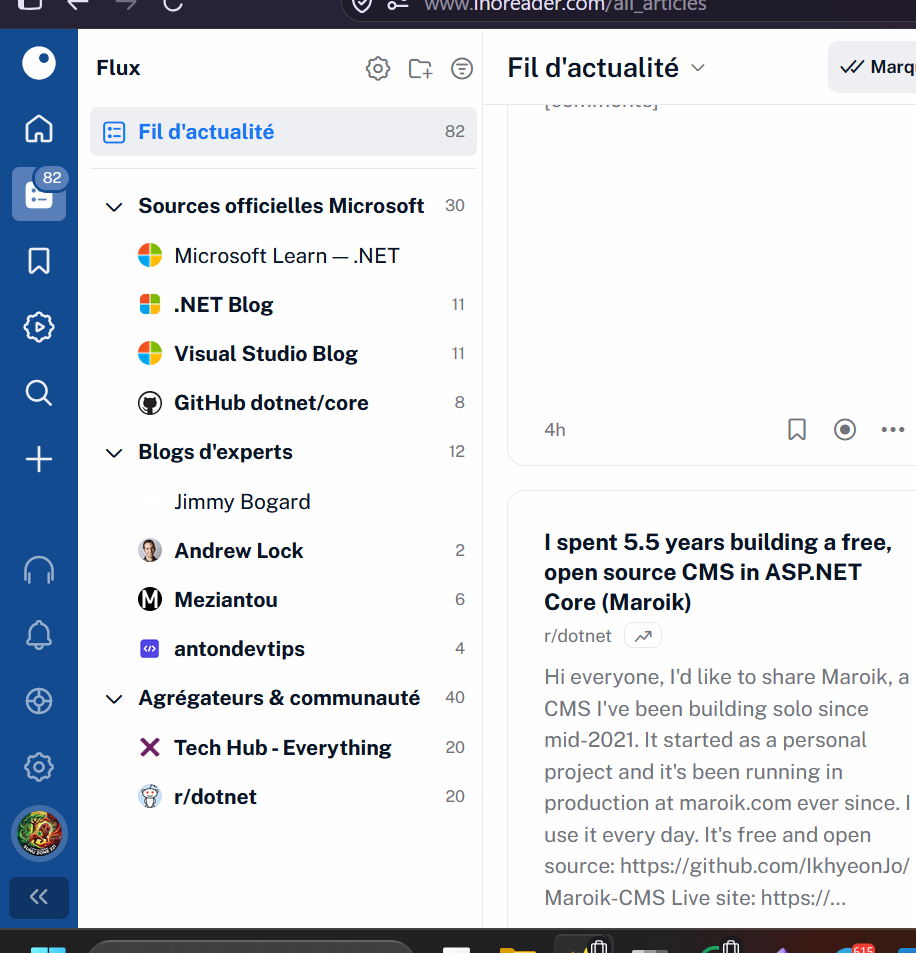

# TD — Veille technologique autour de .NET & C#

**Université Cheikh Anta Diop – École Supérieure Polytechnique (ESP) – Département Génie Informatique**
**Génie Logiciel et Systèmes d'Information – Année universitaire 2026/2027 – 2ᵉ année**
**Étudiant : Khadimou Rassoul Mbacké Mbaye · Chargé de cours : E. H. Ousmane Diallo · Date : 17 novembre 2026**

Ce document répond aux trois livrables du TD : **tableau de bord de veille (10 pts)**, **lien des abonnements à des influenceurs (10 pts)** et **résumé écrit justifié (20 pts)**.

---

## 1. Présentation et objectifs

Ce travail met en place un **système de veille technologique structuré et opérationnel** centré sur l'écosystème **.NET, C# et les technologies Microsoft**.

Objectifs atteints :

1. Identifier les outils et ressources nécessaires à une veille efficace ;
2. Construire un tableau de bord de veille utilisable au quotidien ;
3. Sélectionner et suivre des influenceurs du domaine ;
4. Justifier le nombre de sources, les sujets couverts et les critères de pertinence.

---

## 2. Technologies et thématiques suivies

| Thématique | Pourquoi la suivre |
|---|---|
| **.NET Runtime & SDK** (.NET 10 LTS, .NET 11 STS) | Versions supportées, performance, Native AOT, runtime async, sécurité |
| **C# 14 / C# 15** | Évolutions du langage : `field`, extension members (C# 14) ; unions, closed hierarchies (C# 15) |
| **ASP.NET Core** | Web APIs, Minimal APIs, Blazor, OpenAPI |
| **Entity Framework Core** | ORM, LINQ, migrations, nouveautés EF Core 11 |
| **Visual Studio / VS Code / Rider** | Outillage, productivité, assistants IA |
| **Azure + .NET** | Déploiement cloud, conteneurs, services IA |
| **Sécurité & servicing** | Correctifs mensuels (Patch Tuesday), CVE, fins de support |
| **IA / agents dans .NET** | Semantic Kernel, MCP, outils de développement assistés |
| **Performance & diagnostics** | Benchmarks, mémoire, async, profiling |

Ces sujets couvrent à la fois les annonces officielles de Microsoft et les besoins concrets d'un développeur .NET en 2026/2027 : choisir une version, migrer, apprendre les nouvelles fonctionnalités, sécuriser et optimiser.

---

## 3. Critères de pertinence et nombre de sources

### Critères

Une source est retenue si elle satisfait **au moins 4 des 6 critères** suivants :

1. **Autorité / expertise** : auteur reconnu (équipe Microsoft, MVP, auteur de bibliothèques ou de livres majeurs) ;
2. **Actualité** : contenu mis à jour régulièrement (au moins 1 à 2 publications par mois) ;
3. **Profondeur technique** : explications, code, benchmarks — pas seulement des titres ;
4. **Indépendance relative** : mélange de sources officielles et de voix communautaires plus critiques ;
5. **Accessibilité** : flux RSS, newsletter ou compte social facile à consommer ;
6. **Impact** : influence mesurable dans la communauté (citations, abonnés, étoiles GitHub).

### Nombre adéquat de sources

**10 sources principales** (fourchette recommandée : **8 à 12**) : 4 officielles + 4 blogs d'experts + 2 agrégateurs. C'est assez pour couvrir l'officiel, la technique approfondie et la communauté, sans surcharge. Au-delà, le bruit augmente, les doublons se multiplient et la veille devient impossible à tenir dans la durée.

S'y ajoutent **4 chaînes YouTube** (format vidéo complémentaire, même sélection au seuil 4/6) et **10 comptes d'influenceurs** sur X — voir sections 5 et 6.

---

## 4. Tableau de bord de veille (Livrable 1)

### 4.1 Les 10 sources retenues

#### Sources officielles Microsoft (4)

| Source | URL | Rôle |
|---|---|---|
| **.NET Blog** | https://devblogs.microsoft.com/dotnet/ (RSS : `/feed/`) | Annonces de versions, nouveautés, sécurité, dates de support |
| **Visual Studio Blog** | https://devblogs.microsoft.com/visualstudio/ | Outils, IDE, assistants IA |
| **GitHub dotnet/core** | https://github.com/dotnet/core | Notes de version, discussions, correctifs de sécurité (RSS : `releases.atom`) |
| **Microsoft Learn – Nouveautés .NET** | https://learn.microsoft.com/dotnet | Documentation officielle de référence |

#### Blogs techniques d'experts (4)

| Source | URL | Focus |
|---|---|---|
| **Andrew Lock – .NET Escapades** | https://andrewlock.net/ | ASP.NET Core, diagnostics, analyses approfondies |
| **Meziantou's blog** | https://www.meziantou.net/ | Performance, async, outillage, fonctionnement interne |
| **Jimmy Bogard** | https://jimmybogard.com/ | Architecture, DDD, bibliothèques populaires |
| **Anton Martyniuk (antondevtips)** | https://antondevtips.com/ | Guides pratiques à chaque nouvelle version de .NET et C# (article .NET 11/C# 15 publié le jour de la sortie) |

#### Agrégateurs et communauté (2)

| Source | URL | Utilité |
|---|---|---|
| **Tech Hub – .NET Roundups** | https://tech.hub.ms/dotnet/roundups | Synthèses hebdomadaires de l'actualité .NET |
| **r/dotnet** (Reddit) | https://www.reddit.com/r/dotnet/ | Réactions de la communauté, retours d'expérience, dépannage |

#### Sources vidéo — YouTube (4 chaînes)

| Chaîne | URL | Pourquoi la suivre |
|---|---|---|
| **.NET (officiel Microsoft)** | https://www.youtube.com/@dotnet | Keynotes .NET Conf, sessions produit, démos officielles |
| **Nick Chapsas** | https://www.youtube.com/@nickchapsas | Tutoriels et bonnes pratiques .NET très suivis (format court) |
| **Raw Coding** | https://www.youtube.com/@RawCoding | Architecture, patterns et profondeur technique .NET |
| **IAmTimCorey** | https://www.youtube.com/@IAmTimCorey | Apprentissage structuré C#/.NET, formats longs |

> Les chaînes YouTube sont abonnées via l'onglet **Abonnements** du compte Google et alimentent un onglet dédié du tableau de bord (voir 4.3).

### 4.2 Outils de construction du tableau de bord

- **Inoreader** (outil retenu, voir captures en 4.5) : agrégation des flux RSS via l'import du fichier `flux.opml` fourni en annexe ; Feedly reste une alternative ;
- **Notion ou Obsidian** : tableau de bord personnel (notes, statut « lu / à tester ») ;
- **Listes X / LinkedIn** : suivi des influenceurs ;
- **Abonnements YouTube** : playlist « À voir » des 4 chaînes ;
- **Notifications GitHub** (Watch → Releases) : suivi de dotnet/core, dotnet/runtime, dotnet/aspnetcore.

### 4.3 Structure du tableau de bord

1. **Actualités de la semaine** : derniers articles du .NET Blog, du roundup hebdomadaire et des chaînes YouTube ;
2. **Releases & support** : versions en cours et dates de fin de support ;
3. **Fonctionnalités C# / runtime à tester** ;
4. **Sécurité** : correctifs et CVE ;
5. **Articles techniques à lire** ;
6. **Influenceurs & discussions** ;
7. **À expérimenter** : petits POC personnels.

### 4.4 Contenu actuel (novembre 2026)

#### Releases & support (vérifié sur la politique de support Microsoft, mise à jour le 10/11/2026)

| Version | Type | Sortie | Fin de support | Statut |
|---|---|---|---|---|
| **.NET 11 / C# 15** | STS (24 mois) | 10 novembre 2026 | **14 novembre 2028** | Sorti — à tester |
| **.NET 10 / C# 14** | LTS | 11 novembre 2025 | **14 novembre 2028** | Version de référence |
| **.NET 8** | LTS | 14 novembre 2023 | **10 novembre 2026** | **Fin de support** |
| **.NET 9** | STS (24 mois) | 12 novembre 2024 | **10 novembre 2026** | **Fin de support** |

> Point notable : depuis l'allongement du STS de 18 à 24 mois (septembre 2025), .NET 11 et .NET 10 expirent **le même jour** ; choisir .NET 11 apporte des fonctionnalités, pas du temps de support supplémentaire. Toute application encore sur .NET 8 ou .NET 9 ne reçoit plus aucun correctif de sécurité.

#### Actualités de la semaine

- **.NET 11 GA** (10 novembre 2026), annoncé dès le premier jour du **.NET Conf 2026** (10–13 novembre) ;
- **C# 15** : *union types* et *closed hierarchies* pour modéliser les états possibles d'une application avec vérification par le compilateur ; aussi arguments de collection `with(...)`, indexeurs d'extension, `break`/`continue` étiquetés ;
- **Runtime** : runtime async natif (aperçu), optimisations de performance, compression Zstandard intégrée ;
- **ASP.NET Core** : OpenAPI 3.2 par défaut, validation async, modèle de serveur MCP dans le SDK ;
- **Sécurité** : derniers correctifs mensuels du 10 novembre — 8.0.34 et 9.0.23 étaient les derniers patches des versions EOL.

#### Fonctionnalités à tester

- **C# 14** (avec .NET 10) : mot-clé `field`, extension members, affectation conditionnelle null (`?.=`) ;
- **C# 15** (avec .NET 11) : types union, hiérarchies fermées, arguments `with(...)` dans les expressions de collection ;
- **Migration** : migrer un petit projet .NET 8 vers .NET 10 ou 11 ;
- **POC** : écrire un type union C# 15 pour un résultat d'API (succès / erreur de validation / introuvable).

#### À lire en priorité

- Annonce officielle : https://devblogs.microsoft.com/dotnet/announcing-dotnet-11/
- Nouveautés .NET 11 et C# 15 (Anton Martyniuk) : https://antondevtips.com/blog/new-features-in-dotnet-11-and-csharp-15
- What's new in C# 15 (Microsoft Learn) : https://learn.microsoft.com/dotnet/csharp/whats-new/csharp-15
- Fin de support .NET 8/9 : https://devblogs.microsoft.com/dotnet/dotnet-8-9-end-of-support

### 4.5 Mise en œuvre concrète — captures du tableau de bord (17/11/2026)

Le tableau de bord est **opérationnel sur Inoreader** : le fichier `flux.opml` a été importé via *Importer des flux* :

**Étape 1 — Import du fichier OPML :**



**Étape 2 — Les 10 sources réparties en 3 dossiers (82 articles non lus) : Sources officielles 30 · Blogs d'experts 12 · Agrégateurs 40 :**



**Étape 3 — Fil d'actualité alimenté en temps réel (articles r/dotnet, .NET 11, ASP.NET Core…) :**



---

## 5. Influenceurs suivis (Livrable 2)

Compte dédié à la veille .NET sur **X (Twitter)** (ou LinkedIn si les profils n'y sont pas actifs).

### 10 comptes X sélectionnés

| Influenceur | Handle X | Pourquoi le suivre |
|---|---|---|
| Scott Hanselman | @shanselman | Voix majeure de Microsoft et de la communauté, culture développeur |
| Damian Edwards | @DamianEdwards | Architecte ASP.NET Core / Aspire |
| David Fowler | @davidfowl | Architecte .NET, conception interne d'ASP.NET Core |
| Stephen Toub | @stephentoub | Performance et librairies de base .NET |
| Mads Torgersen | @MadsTorgersen | Lead designer du langage C# |
| Andrew Lock | @andrewlocknet | Analyses ASP.NET Core de grande qualité |
| Jimmy Bogard | @jbogard | Architecture, DDD, bibliothèques populaires |
| Anton Martyniuk | @AntonMartyniuk | Guides pratiques à chaque version, MVP |
| Stefan Dokic | @TheCodeMan__ | Contenu pratique .NET et IA |
| .NET (officiel) | @dotnet | Annonces officielles |

### Chaînes YouTube suivies (onglet Abonnements)

`.NET` (@dotnet) · `Nick Chapsas` · `Raw Coding` · `IAmTimCorey` — voir section 4.1.

**Lien du livrable 2 :**

```
https://x.com/rk2m_007/following
```

> Profil public : https://x.com/rk2m_007 — les 10 comptes de la liste ci-dessus sont suivis depuis ce compte.

---

## 6. Résumé écrit du travail (Livrable 3)

### Démarche

1. **Thématiques** : focus strict sur l'écosystème Microsoft (.NET, C#, ASP.NET Core, EF Core, outils, Azure, sécurité, IA) ;
2. **Sources** : 4 sources officielles, 4 blogs d'experts, 2 agrégateurs communautaires, soit **10 sources principales** (dans la fourchette 8–12), complétées par **4 chaînes YouTube** pour le format vidéo ;
3. **Critères** : autorité, actualité, profondeur technique, indépendance, accessibilité, impact — une source doit en remplir **au moins 4 sur 6** ;
4. **Outils** : RSS (Feedly / Inoreader avec import OPML), tableau de bord Notion / Obsidian, listes X, abonnements YouTube, notifications GitHub ;
5. **Réseaux sociaux** : 10 comptes d'influenceurs reconnus, des architectes Microsoft aux auteurs communautaires.

### Justification des choix

- **Les sources Microsoft** garantissent l'information officielle, notamment les dates de support (capital : .NET 8 et 9 ont perdu tout support le 10 novembre 2026) ;
- **Les blogs d'experts** (Andrew Lock, Meziantou, Jimmy Bogard, Anton Martyniuk) apportent la profondeur technique et les retours d'expérience que la communication officielle ne donne pas ;
- **Les roundups et r/dotnet** permettent de rester informé sans tout lire et donnent le point de vue de la communauté, plus critique ;
- **Les chaînes YouTube** couvrent le format vidéo (démos, keynotes, tutoriels) : utile pour .NET Conf et pour apprendre en continu sans lecture ;
- **Les influenceurs X** offrent la réactivité et le contexte autour des annonces ;
- **Un volume maîtrisé (10 sources + 4 chaînes)** rend la veille tenable sur la durée et évite la surcharge d'information.

### Bénéfices attendus

- Rester à jour sur les versions supportées et les nouveautés de C# et .NET ;
- Anticiper les migrations : fin de support de .NET 8 et 9 le 10 novembre 2026 → migrer vers .NET 10 (LTS) ou .NET 11 (STS) ;
- Améliorer ses pratiques en performance, sécurité et architecture ;
- Développer une culture technique solide pour la suite du cursus et la vie professionnelle.

---

## 7. Annexe

### Flux RSS à importer (fichier `flux.opml` fourni avec ce dépôt)

```
https://devblogs.microsoft.com/dotnet/feed/
https://devblogs.microsoft.com/visualstudio/feed/
https://andrewlock.net/rss.xml
https://www.meziantou.net/feed
https://jimmybogard.com/rss.xml
https://antondevtips.com/index.xml
https://github.com/dotnet/core/releases.atom
https://www.reddit.com/r/dotnet/.rss
```

### Liens de référence

- Politique de support .NET : https://dotnet.microsoft.com/platform/support/policy
- Annonce .NET 11 : https://devblogs.microsoft.com/dotnet/announcing-dotnet-11/
- What's new in C# 15 : https://learn.microsoft.com/dotnet/csharp/whats-new/csharp-15
- Fin de support .NET 8 / 9 : https://devblogs.microsoft.com/dotnet/dotnet-8-9-end-of-support
- Releases GitHub : https://github.com/dotnet/core
- .NET Conf 2026 (10–13 novembre) : https://devblogs.microsoft.com/dotnet/announcing-dotnet-11/

---

*Ce rendu couvre les 3 livrables du TD (tableau de bord, influenceurs, résumé écrit) et justifie explicitement les choix demandés dans le sujet.*
